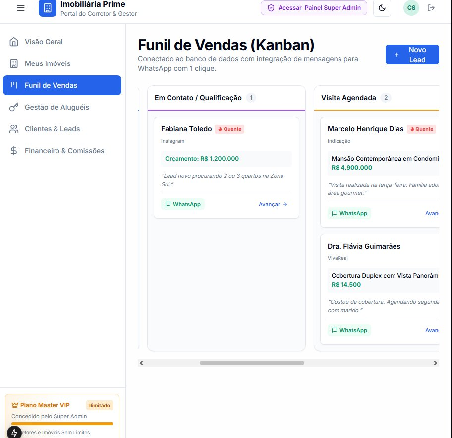

# 🏢 CRM Imobiliário Multi-Tenant & Portal Imobiliária Prime

> Plataforma completa de gestão imobiliária desenvolvida com **Next.js 15**, **React 19**, **Prisma ORM** e **Tailwind CSS**. Atende tanto **Grandes Imobiliárias (PJ)** quanto **Corretores Autônomos (PF)**, contando com portal do corretor, funil de vendas integrado com WhatsApp, gestão de aluguéis e painel Super Admin com controle de planos.


---

## 📸 Screenshots Reais do Sistema

### 1. Funil de Vendas Interativo (Kanban de Leads com WhatsApp 1-Clique)
Acompanhamento visual de cada oportunidade de venda ou locação, com classificação de leads quentes, edição completa de dados, avanço de etapas e botão direto de WhatsApp com mensagem personalizada preenchida automaticamente.



---

### 2. Carteira de Imóveis (Catálogo com Fotos HD e Modais Interativos)
Catálogo completo com fotos arquitetônicas de alta definição, busca automática de endereço por CEP (ViaCEP), filtros dinâmicos por finalidade (Venda/Aluguel) e tipologia, modal de **Detalhes** (com simulador de financiamento e ficha para impressão) e modal de **Edição/Exclusão** conectado ao banco de dados.


---

## 🌟 Principais Recursos

### 🧑‍💼 1. Portal do Corretor & Gestor (`/dashboard`)
* **Visão Geral**: Métricas de VGV (Valor Geral de Vendas), contratos ativos, leads novos e comissões do mês.
* **Carteira de Imóveis**: 
  * Galeria com fotos de capa e carrossel
  * Busca e autopreenchimento de endereço integrado à API **ViaCEP**
  * Modal de Detalhes com **Simulador de Financiamento Caixa/Bancos**
  * Impressão de ficha de visita e link público exclusivo do imóvel (`/imovel/[code]`)
* **Funil de Negociações (Kanban)**:
  * Etapas: *Novo Lead* ➔ *Contato/Qualificação* ➔ *Visita Agendada* ➔ *Proposta Apresentada* ➔ *Fechamento*
  * Integração instantânea com **WhatsApp API**
  * Edição de perfil do lead, orçamento e notas de atendimento
* **Gestão de Locações & Aluguéis**:
  * Controle de contratos, vencimentos e datas de repasse ao proprietário
  * Cálculo de reajuste automático anual (**IPCA** e **IGP-M**)
* **Módulo Financeiro**:
  * Extrato de receitas de corretagem, taxas de administração e despesas operacionais

### 👑 2. Painel Super Admin (`/super-admin`)
* **Gestão Multi-Empresa (Multi-Tenant)**: Gerenciamento unificado de imobiliárias e corretores cadastrados na plataforma.
* **Suporte a PJ e PF**: Cadastro flexível tanto para Imobiliárias com equipe quanto Corretores Autônomos.
* **Controle de Assinaturas & Planos**:
  * Planos públicos: *Básico*, *Profissional*, *Enterprise*.
  * **Plano Exclusivo "Master VIP"**: Plano ilimitado especial não disponível para contratação pública, atribuído exclusivamente pelo Super Admin para parceiros estratégicos.
* **Métricas SaaS Globais**: Faturamento mensal recorrente (MRR), total de licenças e relatórios de uso.

### 🔌 3. Integrações Prontas
* **Feed XML Portais Imobiliários**: Endpoint `/api/feed/zap` pronto no padrão ZAP Imóveis, VivaReal e OLX.
* **ViaCEP**: Preenchimento automático de rua, bairro, cidade e UF a partir do CEP.
* **WhatsApp Web / App**: Disparo com texto inteligente baseado no interesse e imóvel pesquisado pelo cliente.

---

## 🚀 Como Executar Localmente

### Pré-requisitos
* **Node.js** (versão 18 ou superior)
* **npm** ou **pnpm**

### Passo a Passo

```bash
# 1. Clone o repositório
git clone https://github.com/Esamwell/imobiliariaprime.git

# 2. Acesse a pasta do projeto
cd imobiliariaprime

# 3. Instale as dependências
npm install --legacy-peer-deps

# 4. Configure o arquivo de ambiente
cp .env.example .env

# 5. Inicialize e popule o banco de dados local
npx prisma db push
node prisma/seed.js

# 6. Inicie o servidor de desenvolvimento
npm run dev
```

Abra no navegador em **[http://localhost:3000](http://localhost:3000)**.

---

## 🔑 Contas de Demonstração (Seed)

| Perfil | E-mail | Senha | Acesso |
| :--- | :--- | :--- | :--- |
| **Super Admin** | `admin@sistema.com` | `123456` | `/super-admin` |
| **Imobiliária Prime (Gestor)** | `carlos@primeimoveis.com.br` | `123456` | `/dashboard` |
| **Mariana Alencar (Corretora)** | `mariana@primeimoveis.com.br` | `123456` | `/dashboard` |

*(A tela de login conta com botões de **Acesso Rápido em 1 Clique** para alternar entre os perfis sem digitar senha).*

---

## ☁️ Deploy na Vercel

O projeto está otimizado para deploy imediato na **Vercel**:

1. Faça login em [vercel.com](https://vercel.com) com a sua conta do GitHub.
2. Clique em **"New Project"** e importe o repositório **`Esamwell/imobiliariaprime`**.
3. Adicione as Variáveis de Ambiente (**Environment Variables**):
   * `JWT_SECRET`: uma chave aleatória e segura.
   * `DATABASE_URL`: URL do seu banco na nuvem (PostgreSQL via Neon / Supabase, ou MySQL via Aiven).
4. Clique em **Deploy**!

---

## 📄 Licença
Distribuído sob a licença MIT. Veja `LICENSE` para mais informações.
